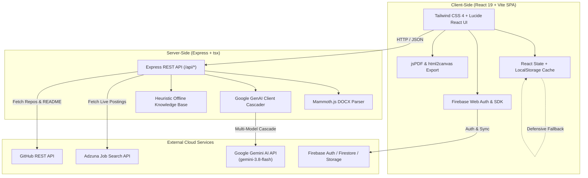

# JobPlanner

<div align="center">

  

  # Plan Your Skills. Get Your Dream Job.

  **An AI-powered career readiness, skill gap analysis, resume building, and interview preparation platform.**

  [](https://react.dev/)
  [](https://www.typescriptlang.org/)
  [](https://vitejs.dev/)
  [](https://tailwindcss.com/)
  [](https://nodejs.org/)
  [](https://ai.google.dev/)
  [](https://firebase.google.com/)

</div>

---

## Table of Contents

- [Project Overview](#project-overview)
- [Problem Statement](#problem-statement)
- [Project Objectives](#project-objectives)
- [Key Features Implemented](#key-features-implemented)
- [Planned Features and Future Enhancements](#planned-features-and-future-enhancements)
- [Technology Stack](#technology-stack)
- [Application Architecture](#application-architecture)
- [Project Folder Structure](#project-folder-structure)
- [Prerequisites](#prerequisites)
- [Installation and Setup](#installation-and-setup)
- [Environment Variables Configuration](#environment-variables-configuration)
- [Firebase and Database Setup](#firebase-and-database-setup)
- [Authentication Setup](#authentication-setup)
- [Development and Build Commands](#development-and-build-commands)
- [Available Scripts](#available-scripts)
- [Backend API Documentation](#backend-api-documentation)
- [Security Considerations](#security-considerations)
- [Contributing](#contributing)
- [Author](#author)
- [License](#license)

---

## Project Overview

**JobPlanner** is a modern, full-stack career preparation and readiness platform built for college students, fresh graduates, and career changers. It consolidates disparate career preparation workflows—skill gap evaluation, industry benchmarking, learning roadmaps, ATS-friendly resume creation, dynamic mock interviews, job discovery, and portfolio curation—into a single unified dashboard.

Powered by **Google Gemini AI** with an offline heuristic fallback engine, JobPlanner ensures uninterrupted functionality even when offline or unauthenticated. It provides personalized guidance tailored to each user's unique academic background, target role, and career goals.

---

## Problem Statement

Entering the modern tech job market presents several steep hurdles for job seekers and students:

1. **Unclear Skill Benchmarks**: Candidates struggle to identify the exact technical and soft skills demanded by employers for specific roles (e.g., Full Stack Developer vs. ML Engineer vs. Cloud/DevOps).
2. **Disconnected Preparation Sinks**: Learning roadmaps, resume editing, interview prep, and job applications usually live in separate, disconnected tools, leaving users without a unified metric of their hiring readiness.
3. **The ATS Black Box**: Over 75% of resumes are rejected by Applicant Tracking Systems (ATS) due to formatting errors, missing keywords, or weak action verbs, without actionable feedback to the candidate.
4. **Lack of Objective Interview Practice**: Candidates lack access to personalized technical and behavioral mock interviewers that evaluate responses against standardized hiring frameworks (such as the STAR method).
5. **Portfolio Under-Utilization**: Junior developers often struggle to effectively showcase their GitHub repositories, quantify project impact, and highlight key technologies to recruiters.

---

## Project Objectives

- **Deliver an Integrated Career Hub**: Unify readiness scoring, skill gap diagnostics, resume building, interview simulations, application tracking, and developer portfolios under one dashboard.
- **Provide Actionable Skill Gap Diagnostics**: Benchmark candidate skills against industry standards, identify core and secondary gaps, and recommend hands-on projects to bridge them.
- **Empower Candidates with ATS-Grade Resumes**: Enable real-time ATS scoring, AI-assisted bullet point optimization, multiple export formats, and template customization.
- **Deliver Realistic Mock Interview Practice**: Provide dynamic question generation, speech/text answer evaluation with STAR methodology feedback, and comprehensive session report cards.
- **Ensure High Reliability**: Deliver server-side AI via Google Gemini models (`gemini-3.8-flash`, `gemini-flash-latest`, `gemini-3.1-flash-lite`) alongside an offline fallback engine and defensive LocalStorage caching.

---

## Key Features Implemented

### 1. Unified Career Readiness Dashboard
- **Overall Readiness Metric (0–100%)**: Multi-dimensional scoring across Technical Skills, Projects & Portfolio, Education, Resume Quality, and Interview Preparedness.
- **Weekly Career Goals**: Interactive checklist for weekly milestones (e.g., roadmap tasks, mock sessions, resume updates).
- **Application Pipeline Snapshot**: Quick-glance metrics for bookmarked, applied, interviewing, and offered job roles.
- **Role Benchmarks**: Immediate salary ranges, required skills, and recommended competencies for 8+ tech specializations.

### 2. AI Skill Gap Analysis (Multimodal Resume Parsing)
- **Resume Upload & Extraction**: Direct client-to-server extraction of PDF and DOCX resumes using `mammoth`.
- **Target Role Benchmarking**: In-depth comparison against roles including Full Stack Developer, Data Analyst, Machine Learning Engineer, Cloud/DevOps Engineer, QA/Test Automation, Backend Developer, and Product Analyst.
- **Prioritized Gaps**: Categorizes missing skills into `HIGH`, `MEDIUM`, and `LOW` priorities with rationale.
- **Actionable Project Recommendations**: Generates tailored project concepts specifically designed to demonstrate the missing competencies.
- **Resilient Fallback Engine**: If Gemini is unconfigured or unavailable, an internal heuristic knowledge base executes benchmark comparisons offline.

### 3. Phased Learning Roadmaps & "What Next?" Engine
- **Multi-Phase Roadmaps**: Structured stages (Foundations, Core Competencies, Advanced Topics, Capstone Projects) with estimated durations and learning objectives.
- **Interactive Task Tracker**: Check off specific learning milestones with progress saved to Firestore and LocalStorage.
- **Curated Learning Resources**: Recommended courses, official documentation, and project tutorials.
- **"What Should I Do Next?" Advisor**: Contextual recommendation engine that analyzes pending tasks and suggests the highest-impact immediate activity.

### 4. Professional ATS-Optimized Resume Builder
- **Multiple Industry Templates**: Modern, Minimalist, Tech, and Executive design layouts.
- **Live ATS Score**: Evaluates keyword density, bullet structure, quantification, contact details, and section completeness.
- **AI Section Enhancer**: Real-time generation of executive summaries, experience bullet points, and project descriptions.
- **Keyword Matcher**: Compares candidate resumes against target job descriptions to identify missing keywords.
- **Multi-Format Export**: Direct download as PDF (`jspdf` + `html2canvas`), Microsoft Word (`.doc`), Plain Text (`.txt`), and browser print layout.

### 5. Interactive AI Mock Interview Simulator
- **Dynamic Questions**: Technical, Behavioral (HR), and System Design questions tailored to role, seniority, and skill set.
- **STAR Answer Evaluation**: Assesses candidate responses across **Situation, Task, Action, and Result**, providing individual ratings (1–10) and constructive critique.
- **Speech & Text Input**: Supports both typed answers and real-time browser voice recognition.
- **Session Report Cards**: Generates downloadable end-of-interview performance reports with average scores, key strengths, improvement areas, and follow-up guidance.

### 6. 24/7 Context-Aware Career Assistant
- **AI Career Coach**: Conversational assistant grounded in the user's current profile, target role, skill gaps, and interview history.
- **Quick-Prompt Starters**: One-click guidance for salary negotiation, elevator pitches, portfolio reviews, and study plans.
- **Persistent Chat History**: Session threads retained in Firestore and local state.

### 7. Smart Job Recommendations & Adzuna Live Search
- **Live Job Listings**: Direct integration with the **Adzuna Developer Portal API** for real-time market postings.
- **Match Percentage Algorithm**: Calculates candidate match percentage based on skill overlap and experience requirements.
- **Curated Offline Library**: Pre-seeded role listings ensuring job discovery works even without an external API key.
- **Direct Application Links**: External redirects to primary job portals and company career pages.

### 8. Kanban Job Application Tracker
- **Stage Management**: Track opportunities through `Saved`, `Applied`, `Interviewing`, `Offered`, and `Rejected` statuses.
- **AI Application Strategy**: Generates customized outreach messages, company research tips, and interview prep checklists.
- **Next-Action Reminders**: Flags pending follow-ups and deadlines to keep job hunts organized.

### 9. Developer Portfolio & GitHub Analyzer
- **GitHub Profile Analysis**: Fetches public GitHub user profiles, repositories, languages, and star counts via the GitHub REST API.
- **Repository README Analyzer**: Examines project README files to extract technologies, architectural patterns, and project complexity.
- **Portfolio Readiness Score**: Evaluates project variety, documentation, live demo availability, and target role alignment.
- **Public Shareable Portfolios**: Generates hosted, shareable portfolio links (`/portfolio/:publicId`) with recruiter-focused UI.

### 10. Robust Authentication & Data Persistence
- **Firebase Authentication**: Email/password registration, Google OAuth sign-in, and instant guest demo mode.
- **Cloud Firestore**: Real-time document synchronization with user-level isolation and strict security rules.
- **Firebase Storage**: Secure file storage for resumes (PDF/DOCX) and profile avatars.
- **Supabase Support**: Configurable alternate backend persistence.
- **Defensive LocalStorage**: Seamless fallback ensuring full functionality even when cloud services are disconnected.

---

## Planned Features and Future Enhancements

The following features represent the project roadmap and are not yet fully implemented:

- [ ] **Video & Audio Emotion Analysis**: Real-time camera feeds measuring eye contact, pacing, and filler word frequency during mock interviews.
- [ ] **Automated LinkedIn Profile Sync**: Browser extension or OAuth integration to import work experiences and recommendations directly.
- [ ] **One-Click Application Autofill**: Browser companion to autofill job applications on Greenhouse, Lever, and Workday.
- [ ] **Peer-to-Peer Mock Interviews**: Live WebRTC rooms for collaborative coding and peer interview practice.
- [ ] **Offer Comparison & Salary Negotiation Calculator**: Cost-of-living adjustments, equity vesting schedules, and compensation benchmarking.

---

## Technology Stack

| Layer | Technologies |
| :--- | :--- |
| **Frontend Framework** | [React 19](https://react.dev/) with [TypeScript 5.8](https://www.typescriptlang.org/) |
| **Build Tool & Bundler** | [Vite 6](https://vitejs.dev/) & [esbuild](https://esbuild.github.io/) |
| **Styling & Design System** | [Tailwind CSS 4](https://tailwindcss.com/) with `@tailwindcss/vite` |
| **Animation & UI Icons** | [Motion](https://motion.dev/) (Framer Motion v12) & [Lucide React](https://lucide.dev/) |
| **Backend API Server** | [Express 4](https://expressjs.com/) executed via `tsx` (TypeScript Execute) |
| **AI / Large Language Models** | [Google Gemini API](https://ai.google.dev/) (`@google/genai` SDK) |
| **Cascading AI Models** | `gemini-3.8-flash` $\rightarrow$ `gemini-flash-latest` $\rightarrow$ `gemini-3.1-flash-lite` |
| **Cloud Authentication** | [Firebase Auth](https://firebase.google.com/docs/auth) (Email/Password, Google OAuth) |
| **Database & Cloud Storage** | [Cloud Firestore](https://firebase.google.com/docs/firestore) & [Firebase Storage](https://firebase.google.com/docs/storage) |
| **Alternative Database** | [Supabase](https://supabase.com/) (`@supabase/supabase-js`) |
| **Document & PDF Processing**| [Mammoth.js](https://github.com/mwilliamson/mammoth.js) (DOCX), [jsPDF](https://github.com/parallax/jsPDF), [html2canvas](https://html2canvas.hertzen.com/) |
| **External Job APIs** | [Adzuna Developer Portal API](https://developer.adzuna.com/) |
| **Developer Profiling** | [GitHub REST API v3](https://docs.github.com/en/rest) |

---

## Application Architecture



---

## Project Folder Structure

```
JOBPLANNER/
├── public/
│   ├── assets/
│   │   ├── aistudio/
│   │   └── jobplanner-logo.svg        # Official vector brand logo
│   └── favicon.svg                    # Application favicon
├── src/
│   ├── components/
│   │   ├── portfolio/
│   │   │   ├── GitHubAnalyzerCard.tsx      # GitHub profile and repo statistics
│   │   │   ├── PortfolioReadinessCard.tsx   # Project quality scoring
│   │   │   ├── PortfolioTemplates.tsx       # Portfolio visual templates
│   │   │   ├── PortfolioView.tsx            # Main developer portfolio hub
│   │   │   ├── ProjectAICard.tsx            # AI project critique card
│   │   │   ├── ProjectModal.tsx             # Add/Edit project modal
│   │   │   ├── PublicPortfolioModal.tsx     # Shareable link generator modal
│   │   │   └── PublicPortfolioPage.tsx      # Public-facing recruiter view
│   │   ├── CareerAnalyticsView.tsx    # Analytics, metrics, and progress charts
│   │   ├── CareerAssistantView.tsx    # 24/7 AI Career Coach chat interface
│   │   ├── CareerReportModal.tsx      # Comprehensive career audit report
│   │   ├── DashboardView.tsx          # Overview dashboard with readiness stats
│   │   ├── FirebaseAuthModal.tsx      # Login, registration, and password reset
│   │   ├── InterviewPrepView.tsx      # AI mock interview simulator
│   │   ├── JobApplicationsView.tsx    # Kanban job application tracking board
│   │   ├── JobRecommendationsView.tsx # Adzuna job search & recommendations
│   │   ├── LoginPage.tsx              # Standalone landing and authentication page
│   │   ├── Logo.tsx                   # Brand logo component
│   │   ├── Navbar.tsx                 # Top navigation and profile controls
│   │   ├── OnboardingModal.tsx        # Profile setup modal
│   │   ├── OnboardingPage.tsx         # Comprehensive student onboarding wizard
│   │   ├── ReadinessView.tsx          # Readiness score breakdown details
│   │   ├── ResumeBuilderView.tsx      # ATS-friendly interactive resume builder
│   │   ├── ResumeSection.tsx          # Resume section editing helpers
│   │   ├── RoadmapView.tsx            # Phased learning roadmap & milestones
│   │   ├── SkillGapView.tsx           # AI skill gap analysis & benchmark view
│   │   └── SupabaseConfigModal.tsx    # Optional Supabase connection modal
│   ├── lib/
│   │   ├── analyticsCalculator.ts     # Readiness and progress calculation algorithms
│   │   ├── defaultData.ts             # Pre-seeded role benchmarks, skills & mock data
│   │   ├── firebase.ts                # Firebase client SDK initialization & Firestore methods
│   │   ├── portfolioUtils.ts          # Portfolio readiness algorithms
│   │   ├── resumeExport.ts            # Client-side PDF, DOC, and TXT exporters
│   │   └── supabase.ts                # Supabase client initialization
│   ├── types/
│   │   └── index.ts                   # Comprehensive TypeScript type definitions
│   ├── App.tsx                        # Root application component & routing state
│   ├── index.css                      # Tailwind CSS v4 design system styles
│   ├── main.tsx                       # React DOM entry point
│   └── vite-env.d.ts                  # Vite client environment types
├── .env.example                       # Documented environment variable template
├── .gitignore                         # Git exclusion rules for secrets & build output
├── bun.lock                           # Bun dependency lockfile
├── firebase-applet-config.json        # Client Firebase configuration
├── firebase-blueprint.json            # Firestore schema definition
├── firestore.rules                    # Production Firestore security rules
├── index.html                         # SPA entry HTML
├── metadata.json                      # Project metadata
├── package-lock.json                  # NPM dependency lockfile
├── package.json                       # Scripts, dependencies, and project metadata
├── server.ts                          # Express API server with Vite middleware & Gemini AI
├── storage.rules                      # Firebase Storage security rules
├── tsconfig.json                      # TypeScript compiler configuration
└── vite.config.ts                     # Vite + Tailwind v4 + React plugin configuration
```

---

## Prerequisites

Before setting up JobPlanner locally, ensure you have the following installed:

- **Node.js**: `v18.0.0` or higher (tested on Node `v24.x`)
- **Package Manager**: `npm` (v9+), `bun`, or `yarn`
- **Git**: For source version control
- *(Optional)* **Google Gemini API Key**: For server-side AI features ([Google AI Studio](https://aistudio.google.com/))
- *(Optional)* **Firebase Project**: For cloud account persistence ([Firebase Console](https://console.firebase.google.com/))
- *(Optional)* **Adzuna API Credentials**: For live job search ([Adzuna Developer Portal](https://developer.adzuna.com/))

> [!NOTE]
> JobPlanner includes built-in offline knowledge bases, local storage persistence, and mock job data. The application operates fully out-of-the-box even without external API keys.

---

## Installation and Setup

### 1. Clone the Repository
```bash
git clone https://github.com/singhrohit09/jobplanner.git
cd jobplanner
```

### 2. Install Dependencies
```bash
npm install
```

### 3. Configure Environment Variables
Create your local environment file by copying the example template:
```bash
cp .env.example .env
```
*(On Windows PowerShell, use `Copy-Item .env.example .env`)*

Open `.env` and fill in your optional API keys (detailed below).

---

## Environment Variables Configuration

Configure the following variables in your `.env` or `.env.local` file:

```ini
# =========================================================================
# Google Gemini AI Configuration
# Acquire your free key at: https://aistudio.google.com/
# =========================================================================
GEMINI_API_KEY="your_gemini_api_key_here"

# Application hosting URL (used in production for OAuth redirects)
APP_URL="http://localhost:3000"

# =========================================================================
# Firebase Web Configuration (Client-side)
# Acquire from: Firebase Console -> Project Settings -> Web Apps
# =========================================================================
VITE_FIREBASE_API_KEY="your_firebase_web_api_key"
VITE_FIREBASE_AUTH_DOMAIN="jobplanner-82fef.firebaseapp.com"
VITE_FIREBASE_PROJECT_ID="jobplanner-82fef"
VITE_FIREBASE_STORAGE_BUCKET="jobplanner-82fef.firebasestorage.app"
VITE_FIREBASE_MESSAGING_SENDER_ID="829279120489"
VITE_FIREBASE_APP_ID="your_firebase_app_id"
VITE_FIREBASE_DATABASE_ID="(default)"

# =========================================================================
# Optional: Supabase Configuration
# =========================================================================
VITE_SUPABASE_URL=""
VITE_SUPABASE_ANON_KEY=""

# =========================================================================
# Live Job Search API (Adzuna)
# Register for free credentials at: https://developer.adzuna.com/
# =========================================================================
ADZUNA_APP_ID=""
ADZUNA_APP_KEY=""
```

---

## Firebase and Database Setup

1. Create a Firebase project at the [Firebase Console](https://console.firebase.google.com/).
2. Enable **Firestore Database** in production mode.
3. Enable **Firebase Storage**.
4. Deploy the security rules included in this repository:
   - Apply Firestore rules from [`firestore.rules`](firestore.rules).
   - Apply Storage rules from [`storage.rules`](storage.rules).
5. The complete Firestore database schema is documented in [`firebase-blueprint.json`](firebase-blueprint.json).

### Security Rules Summary
- **Users Collection (`/users/{userId}`)**: Strict user-level isolation—users can only read, write, and update their own document and subcollections (`request.auth.uid == userId`).
- **Public Portfolios (`/public_portfolios/{publicId}`)**: Publicly readable for recruiter viewing; only editable by the authenticated author.
- **Resumes Storage (`/resumes/{userId}/*`)**: Read/write restricted to owner UID; validates maximum file size (10 MB) and allowed MIME types (`application/pdf`, `.docx`).

---

## Authentication Setup

1. In the Firebase Console, navigate to **Authentication** $\rightarrow$ **Sign-in method**.
2. Enable **Email/Password**.
3. Enable **Google** provider and configure your OAuth consent screen.
4. Add `localhost` and your production domain to the **Authorized domains** list in Firebase Authentication settings.
5. In JobPlanner, users can also use **Guest Demo Mode** for immediate access without authentication.

---

## Development and Build Commands

### Start the Development Server
```bash
npm run dev
```
Starts the full-stack Express server with integrated Vite middleware on `http://localhost:3000`.

### Type Check and Lint
```bash
npm run lint
```
Executes TypeScript compiler validation (`tsc --noEmit`) to verify types across all source files.

### Build for Production
```bash
npm run build
```
Builds the optimized frontend bundle via Vite into `dist/` and compiles the backend `server.ts` into a standalone CommonJS bundle at `dist/server.cjs` via `esbuild`.

### Run Production Server
```bash
npm start
```
Starts the compiled Node.js production server (`node dist/server.cjs`).

---

## Available Scripts

| Script | Command | Purpose |
| :--- | :--- | :--- |
| `npm run dev` | `tsx server.ts` | Starts Express development server with live Vite HMR |
| `npm run build` | `vite build && esbuild ...` | Compiles frontend assets and bundles production server |
| `npm run start` | `node dist/server.cjs` | Runs the compiled production server |
| `npm run preview` | `vite preview` | Previews the Vite production build locally |
| `npm run lint` | `tsc --noEmit` | Validates TypeScript types across the entire project |
| `npm run clean` | `rm -rf dist server.js` | Cleans production build artifacts |

---

## Backend API Documentation

The backend server exposes the following REST endpoints on `http://localhost:3000`:

| Method | Endpoint | Description |
| :--- | :--- | :--- |
| `GET` | `/health` | Server health check and Gemini client status |
| `GET` | `/api/health` | API health check probe |
| `POST` | `/api/ai/analyze-skill-gap` | Analyzes profile & uploaded resume (PDF/DOCX) vs target role |
| `POST` | `/api/ai/recommend-jobs` | Queries Adzuna API + computes skill match percentages |
| `POST` | `/api/ai/analyze-readiness` | Computes multidimensional readiness scores |
| `POST` | `/api/ai/generate-roadmap` | Generates a multi-phase learning roadmap |
| `POST` | `/api/ai/resume-feedback` | In-depth resume review and actionable critique |
| `POST` | `/api/ai/generate-resume` | Generates structured resume content from profile |
| `POST` | `/api/ai/improve-resume-section` | Rewrites individual resume sections with action verbs |
| `POST` | `/api/ai/ats-optimize` | Optimizes resume text for ATS keyword alignment |
| `POST` | `/api/ai/interview/generate-question` | Generates dynamic technical/HR interview questions |
| `POST` | `/api/ai/interview/evaluate-answer` | Evaluates answer using STAR criteria with scores |
| `POST` | `/api/ai/interview/generate-report` | Produces final mock interview session report |
| `POST` | `/api/ai/career-assistant/chat` | Conversational career coaching assistant |
| `POST` | `/api/ai/career-roadmap/what-next` | Recommends next best action based on progress |
| `POST` | `/api/ai/career-analytics/insights` | Generates career growth analytics and trends |
| `POST` | `/api/ai/job-applications/strategy` | Generates tailored application outreach strategies |
| `GET` | `/api/github/profile/:username` | Fetches public GitHub repositories and profile metrics |
| `POST` | `/api/github/readme` | Extracts and parses repository README for tech insights |
| `POST` | `/api/ai/portfolio/analyze-project` | Evaluates portfolio project descriptions and quality |

---

## Security Considerations

- **Private Key Isolation**: No secret credentials, Firebase service accounts, or private API keys are ever committed to version control.
- **Environment Isolation**: `.gitignore` comprehensively excludes `.env*` files (preserving only `.env.example`).
- **Server-Side API Calls**: Google Gemini API keys are consumed strictly on the server side (`server.ts`) and never exposed to the client bundle.
- **Least-Privilege Firestore Rules**: Firestore and Storage rules enforce ownership checks (`request.auth.uid == userId`) and deny unauthorized reads/writes by default.
- **Safe Multimodal Parsing**: Resumes uploaded as base64 or fetched from Firebase Storage are parsed in memory using `mammoth` without persisting raw files to local disk.
- **Graceful Error Handling**: Fallback mechanisms prevent credential leakage in error messages if third-party services fail.

---

## Contributing

Contributions are welcome! Please follow these steps to contribute:

1. **Fork the Repository**
2. **Create a Feature Branch**
   ```bash
   git checkout -b feature/your-feature-name
   ```
3. **Commit Your Changes**
   ```bash
   git commit -m "feat: add your feature description"
   ```
4. **Push to the Branch**
   ```bash
   git push origin feature/your-feature-name
   ```
5. **Open a Pull Request** describing your changes.

---

## Author

- **Rohit Singh**
  - GitHub: [@singhrohit09](https://github.com/singhrohit09)

---

## License

This project is licensed under the [MIT License](LICENSE).
